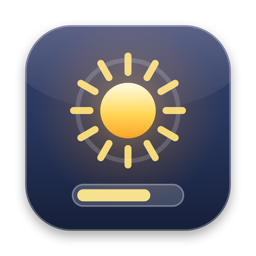
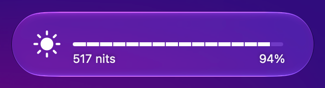
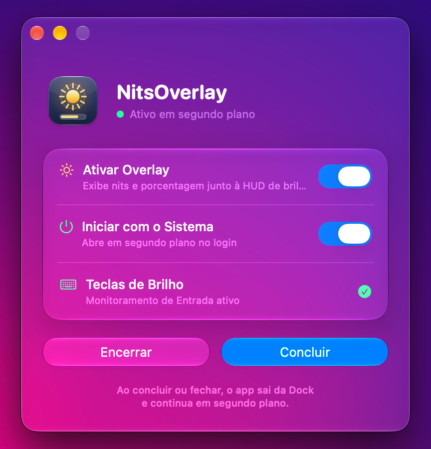

<h1 align="center">
  
  <br>
  NitsOverlay</h1>

Utilitário leve para macOS que exibe o brilho atual da tela em **nits** e **porcentagem (%)** em sincronia com a HUD nativa de brilho do sistema.

## Capturas de Tela

| Pílula de Brilho | Interface de Configuração |
| :---: | :---: |
|  |  |

## Recursos

- **Sincronizado com a HUD nativa**: aparece e desaparece junto com a pílula de brilho do macOS (`MenuBarAgent`) no canto superior direito da tela do MacBook.
- **Zero uso de CPU em repouso**: reage diretamente às teclas de brilho via `CGEventTap` (incluindo `0%` e `100%`).
- **Interface macOS 27 (Liquid Glass)**: janela de configuração minimalista que aparece na Dock apenas enquanto aberta e continua rodando em segundo plano ao fechar.
- **Iniciar com o sistema**: inicialização silenciosa em segundo plano via `LaunchAgent` (`~/Library/LaunchAgents`).

## Requisitos

- macOS 26+ (testado no macOS 27)
- Xcode Command Line Tools (`swiftc`)

## Instalação e Uso

1. Clone o repositório e execute o script de build:
   ```bash
   git clone https://github.com/rodolfostanic/NitsOverlay.git
   cd NitsOverlay
   ./build.sh
   ```
   O aplicativo será compilado, assinado e instalado em `/Applications/NitsOverlay.app`.

2. Na janela inicial, clique em **Autorizar** para conceder permissão de **Monitoramento de Entrada** (*Ajustes do Sistema > Privacidade e Segurança > Monitoramento de Entrada*), necessária para detectar as teclas de brilho.

3. Clique em **Concluir** (ou feche a janela) para ocultar o app da Dock e mantê-lo ativo em segundo plano. Para reabrir as configurações, basta abrir o `NitsOverlay.app` novamente.

## Estrutura

- `NitsOverlay.swift` — código principal da aplicação (HUD, monitoramento de teclas, janela SwiftUI e `AppDelegate`)
- `generate_icon.swift` — gerador vetorial em CoreGraphics do ícone `AppIcon.icns`
- `build.sh` — script de compilação, empacotamento `.app` e assinatura